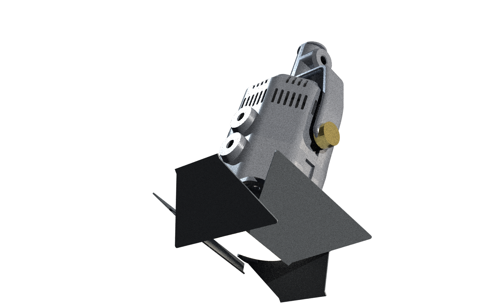
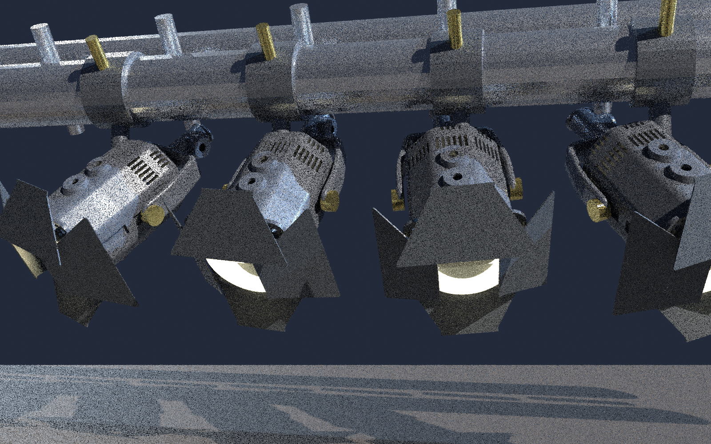
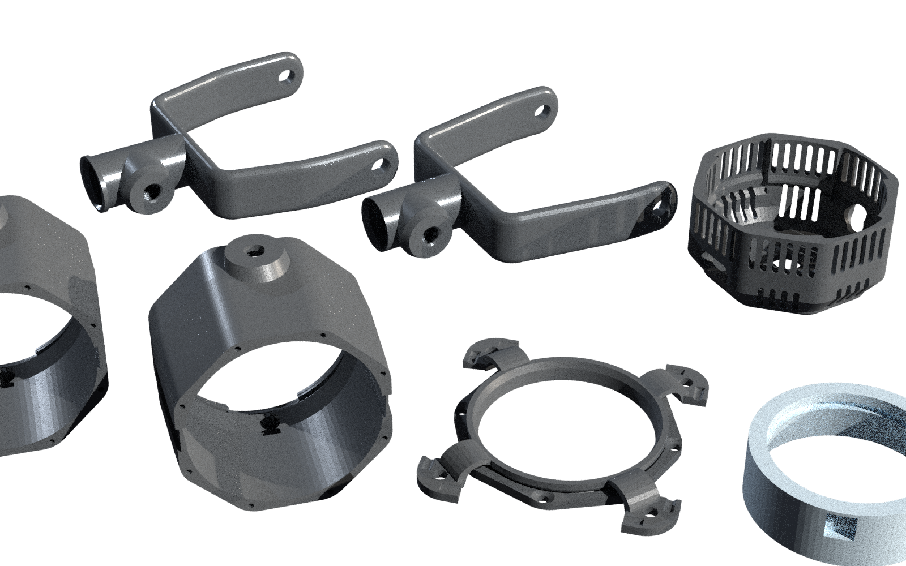
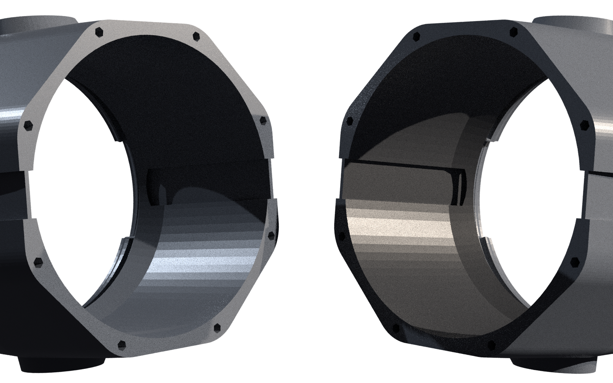
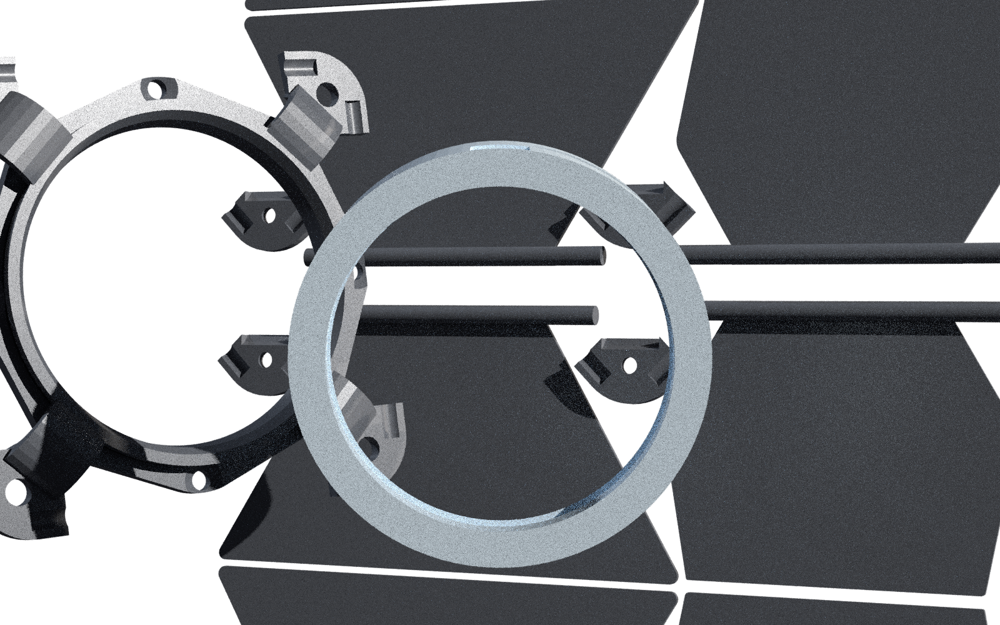
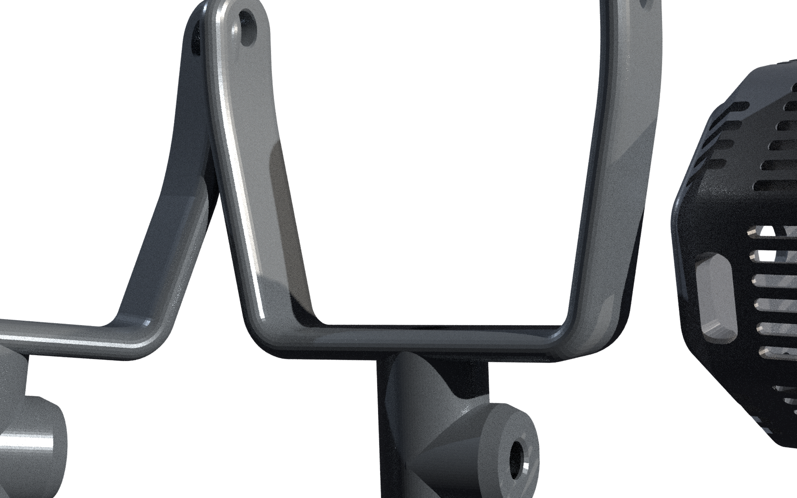
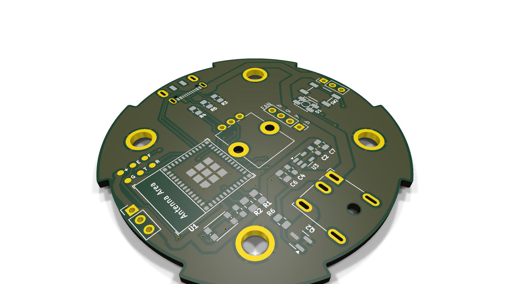
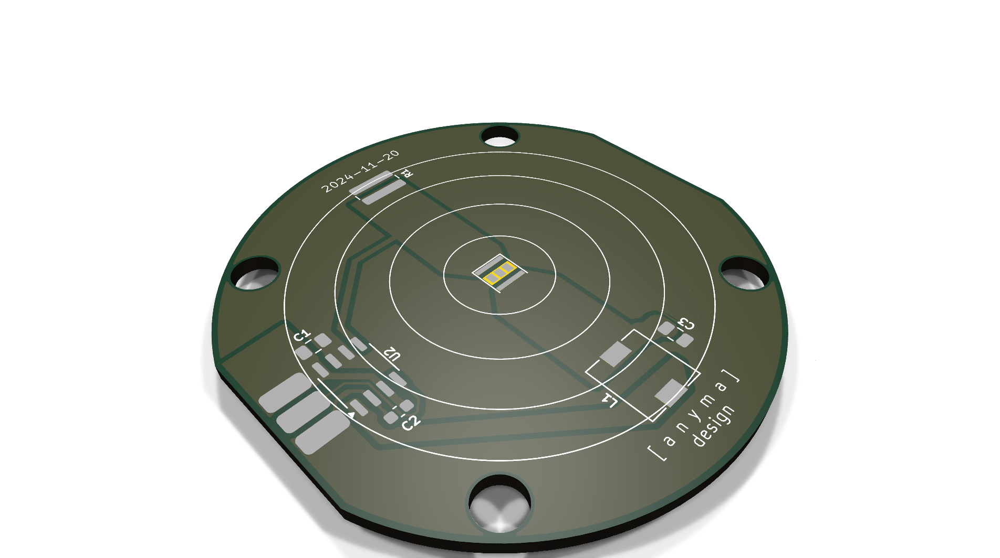
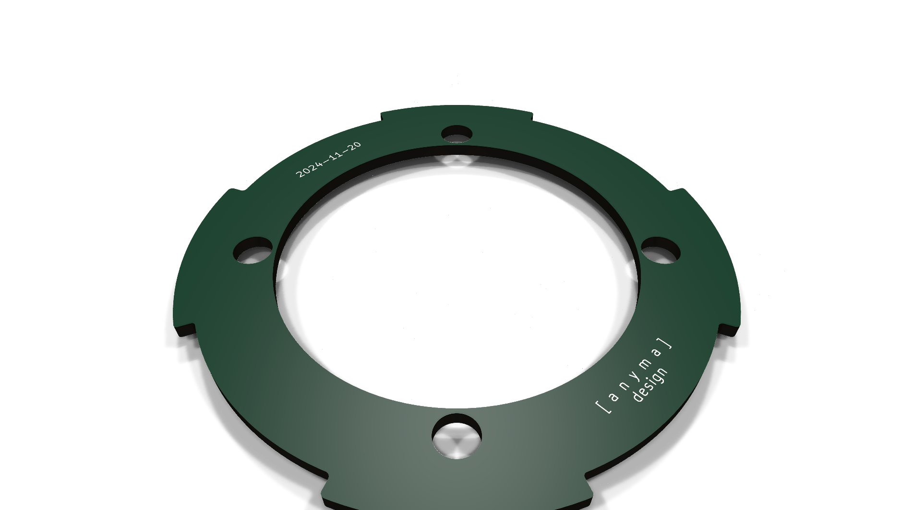
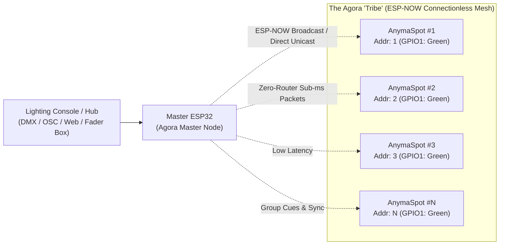

# AnymaSpots 🎭🔦

> **Open-Hardware, 3D-Printable Miniature Theatrical Spotlight with ESP32-C3 Brain & 14-Bit Perceptual Dimming**

[](LICENSE)
[](electronics/)
[](firmware/)
[](docs/README.md)

*This documentation, technical analysis, and 3D raytraced renders were auto-generated by Gemini 3.8 Flash (High) via Antigravity, orchestrating headless Blender Cycles 3D rendering and KiCad CLI board raytracing.*

---

<p align="center">
  
  
  <br/>
  <em>Left: Fully assembled AnymaSpot with 4-blade barndoors, sliding focus barrel, knurled yoke tensioners, and mounting lyre.<br/>Right: Theatrical stage setup — Array of AnymaSpots clamped across an overhead aluminum lighting truss via C-clamps, cross-focused onto the stage.</em>
</p>

---

## What is AnymaSpots?

**AnymaSpots** is an open-source mini stage lighting fixture / profile spotlight designed by multimedia artist, programmer, and tinkerer **Michael Egger** ([**\[ a n y m a \]**](https://anyma.ch/)) in collaboration with the [**SGMK (Swiss Mechatronic Art Society)**](https://github.com/sgmk).

It brings professional theatrical lantern features — including **concentric sliding focus**, **interchangeable theatrical yokes ("lyres")**, **rotatable barndoors ("volets")**, and **high-power Cree LED optics** — into a compact, fully 3D-printable format powered by an **ESP32-C3** microcontroller.

---

## Highlights & Features

- 🔦 **Cree XLamp XP-G LED Engine**: High-efficiency, high-CRI white light emitter driven by an onboard STMicroelectronics **LED2000** 3A monolithic step-down constant-current switching regulator.
- 🎛️ **14-Bit Perceptual Dimming**: Hardware PWM running at 200 Hz with quartic ($\text{intensity}^4$) gamma transfer curve for flicker-free, velvet-smooth fades down to total blackout.
- 🔭 **Adjustable Optical Zoom**: Concentric sliding lens tube allows smooth beam angle and focal adjustment with a 57 mm plano-convex condenser lens.
- 🎬 **Theatrical Beam Framing**: Rotatable front accessory ring accepts a 3-blade articulating barndoor assembly ("volets") for sharp beam trimming and glare suppression.
- 🧠 **ESP32-C3 Control**: Native USB-C programming and serial control, onboard analog potentiometer for manual dimming, push-button, and an **SK6812MINI** addressable RGB status NeoPixel.
- ❄️ **Thermal Management**: Integrated fan drive MOSFET with tachometer sensing and thermal input pin header.
- 🧰 **Modular & 3D Printable**: Engineered to print cleanly on standard desktop FDM printers with zero proprietary fasteners.

---

## 3D Mechanical Showcase

All 3D models were created in SketchUp ([`3d-files/anymaspot.skp`](3d-files/anymaspot.skp)) and exported to printable STL files in [`3d-files/STL/`](3d-files/STL/):

<p align="center">
  
  <br/>
  <em>Knolling overview of all 3D printed mechanical components</em>
</p>

| Spotlight Body & Focus Tube | Barndoor Ring, Blades & Lens Mount |
| :---: | :---: |
|  |  |
| *Cylindrical housing with cooling gills & inner focus barrel* | *Front accessory collar with 3 articulating barndoor flaps* |

<p align="center">
  
  <br/>
  <em>120 mm theatrical yoke, 70 mm compact yoke, and rear control faceplate</em>
</p>

---

## Electronics & PCB Design

The electronics are divided into three modular boards designed in KiCad ([`electronics/`](electronics/)):

| `anymaspot-controller` | `anymaspot-ledboard` | `anymaspot-mounting-ring` |
| :---: | :---: | :---: |
| [](electronics/anymaspot-controller/) | [](electronics/anymaspot-ledboard/) | [](electronics/anymaspot-mounting-ring/) |
| **Brain Board**<br/>ESP32-C3-MINI-1, USB-C, 5–12V DC barrel jack, 3.3V LDO, potentiometer & NeoPixel | **LED Engine & Driver**<br/>Cree XP-G LED emitter + ST LED2000 constant-current step-down regulator | **Structural Ring**<br/>PCB mounting plate with countersunk M4 DIN965 mounting holes |

---

## Repository Structure

```text
AnymaSpots/
├── 3d-files/                     # 3D Mechanical CAD
│   ├── anymaspot.skp             # Master 3D assembly in SketchUp
│   └── STL/                      # Ready-to-slice STL meshes
│       ├── anymaspot-12-short.stl        # Outer body chassis
│       ├── anymaspot-12-tube-short.stl   # Sliding focus barrel
│       ├── anymaspot-12-lyre.stl         # 12cm mounting yoke
│       ├── anymaspot-lyre7.stl           # 7cm compact mounting yoke
│       ├── Biglens.stl                   # 57mm lens holder collar
│       ├── Volet-Ring.stl                # Front barndoor adapter ring
│       ├── volets-x-3.stl                # 3-blade barndoor print sheet
│       └── Back.stl                      # Rear faceplate
├── electronics/                  # KiCad PCB & Schematic Projects
│   ├── anymaspot-controller/     # ESP32-C3 brain & interface
│   ├── anymaspot-ledboard/       # Cree XP-G & LED2000 driver
│   └── anymaspot-mounting-ring/  # M4 structural mounting ring
├── firmware/                     # Embedded Software
│   └── anyspot-basic/            # PlatformIO project for ESP32-C3
│       ├── src/main.cpp          # 14-bit quartic dimming code
│       └── platformio.ini        # Build configurations
├── docs/                         # Documentation & Visual Assets
│   ├── README.md                 # Full engineering & pinout guide
│   ├── artwork/                  # Badges and retro C64 sprites
│   └── renders/                  # 3D raytraced renders (Blender & KiCad)
├── LICENSE                       # GNU General Public License v3.0
└── README.md                     # Project overview
```

---

## Quick Start: Building Firmware

The firmware uses [PlatformIO](https://platformio.org/):

```bash
# 1. Clone your fork
git clone https://github.com/dusjagr/AnymaSpots.git
cd AnymaSpots/firmware/anyspot-basic

# 2. Build the firmware
pio run

# 3. Flash to the ESP32-C3 via USB-C
pio run -t upload

# 4. Open serial monitor (115200 baud)
pio run -t monitor
```

---

## Dimming Code Snippet

The firmware applies a non-linear quartic curve over 14-bit timer hardware to match the human eye's logarithmic perception of light:

```cpp
// 14-bit hardware timer (16,384 discrete levels) at 200 Hz
#define LED_FREQ 200
#define LED_RESOLUTION 14
#define LED_CHANN 0

// Exponential moving average filter on analog input to eliminate noise
ad_val = (7 * ad_val + analogRead(PIN_POT)) / 8;
intensity = (float)ad_val / 4095.0f;

// Quartic perceptual gamma correction curve (intensity^4 * 2^14)
float f = pow(intensity, 4) * pow(2, LED_RESOLUTION);
ledcWrite(LED_CHANN, floor(f));
```

---

---

## Wireless Mesh Architecture: Agora (`mirdej/Agora`)

While `firmware/anyspot-basic` contains local test code for the analog potentiometer and 14-bit PWM driver, AnymaSpots is architected to run [**Agora** (`mirdej/Agora`)](https://github.com/mirdej/Agora) — Michael Egger's lightweight ESP32 library for connectionless **ESP-NOW** communication.



### Why Agora for Theatrical Lighting?
- **Zero-Router Infrastructure**: Avoids heavy 2.4 GHz Wi-Fi access points, router crashes, and IP/DHCP handshakes in crowded performance spaces.
- **Sub-Millisecond Latency**: Connectionless ESP-NOW frame transmissions enable instantaneous blackouts, strobing, and cue execution.
- **The "Tribe" Metaphor**: Spots automatically discover each other and join a designated group ("tribe").
- **Graceful Local Fallback**: The variables already present in `main.cpp` (`address`, `long_address`, `connected`, `muted`, `last_message_millis`) allow automatic fallback to the manual rear potentiometer if Agora connection packets stop arriving (`millis() - last_message_millis > TIMEOUT`).
- **Status Indication**: The onboard `SK6812MINI` NeoPixel indicates Agora connection health (e.g. green for connected, pulsing amber for searching, red for muted).

---

## Next-Gen Optical Exploration: LEP (Laser Excited Phosphor)

A natural and groundbreaking upgrade for the AnymaSpot optical engine is transitioning from traditional high-power LEDs (such as the Cree XLamp XP-G) to **LEP (Laser Excited Phosphor)** technology.

```
Traditional LED: Wide emitting surface (~3.5mm), 120° emission  ==>  Soft beam edge, wide lens required
LEP Technology: 450nm Blue Laser + Micro-Ceramic Phosphor (<0.5mm) ==>  Near-point-source, razor-sharp beam!
```

### Advantages of an LEP Upgrade:
1. **Extreme Luminance & Optical Etendue ($A \cdot \Omega$)**:
   - Standard high-power LEDs have relatively large surface areas ($~3\text{--}9\,\text{mm}^2$), limiting how tightly light can be focused through compact lenses without optical spill.
   - LEP excites a microscopic phosphor target ($<0.5\,\text{mm}$ spot size) using high-power blue laser diodes, generating **up to 10×–50× the luminous intensity ($\text{cd/mm}^2$)** of an LED.
2. **True Profile Spot Performance with 3D Printed Optics**:
   - Because the emitter acts as a near-perfect optical point source, the existing 57 mm condenser lens (`Biglens.stl`) and sliding focus tube (`anymaspot-12-tube-short.stl`) can produce razor-sharp shutter cuts using the 3D-printed barndoors (`Volet-Ring.stl` + `volets-x-3.stl`) with zero fuzzy penumbra or chromatic fringing.
   - Enables tight pencil-beam micro-spots and long-throw stage accents impossible with standard SMD LEDs.
3. **Thermal Architecture**:
   - In LEP modules, the thermal load is concentrated at the blue laser diode heatsink rather than the front optic, simplifying conduction to the chassis backplate while keeping the 3D-printed lens barrel cool.
4. **Engineering Adaptations Needed**:
   - Redesigning the `anymaspot-ledboard` to drive a 450nm laser diode (requiring precision constant-current laser driver circuitry and optical beam enclosure safety to prevent stray unscattered laser leakage).

---

## Roadmap & Fork Ideas

- [ ] **Wireless Art-Net / E1.31 sACN**: Connect to local Wi-Fi to control fixtures directly from lighting software (QLC+, Resolume, MadMapper, GrandMA).
- [ ] **Web UI & Captive Portal**: Onboard web page for setting DMX universe, start address, and dimming curves via mobile browser.
- [ ] **NTC Thermal Feedback**: Read temperature on `GPIO3` to dynamically throttle current and safeguard 3D-printed plastic.
- [ ] **ESP-NOW Master/Follower Mesh**: Group multiple spots into synchronized wireless arrays with zero router setup.

---

## Credits & Community

- **Hardware & Concept**: Michael Egger ([A N Y M A](https://anyma.ch/))
- **Hosted by**: [SGMK (Swiss Mechatronic Art Society)](https://www.mechatronicart.ch/)
- **Fork Maintainer**: Marc Dusseiller ([dusjagr](https://dusseiller.ch/))

---

<div align="center">

[](https://dusseiller.ch/)

*Bruce Lee rules · Open source — hack, remix, share.*

</div>
