# AnymaSpots Technical Documentation

Comprehensive engineering reference for the **AnymaSpots** open-source miniature stage lighting project.

---

## Table of Contents
1. [System Architecture](#system-architecture)
2. [Mechanical Design & Optics](#mechanical-design--optics)
3. [Electronics & PCB Subsystems](#electronics--pcb-subsystems)
   - [anymaspot-controller](#1-anymaspot-controller)
   - [anymaspot-ledboard](#2-anymaspot-ledboard)
   - [anymaspot-mounting-ring](#3-anymaspot-mounting-ring)
4. [Firmware & Dimming Engine](#firmware--dimming-engine)
5. [Pinout & Interconnect Map](#pinout--interconnect-map)
6. [Assembly Instructions](#assembly-instructions)
7. [Enhancement Roadmap](#enhancement-roadmap)

---

## System Architecture

```mermaid
flowchart TD
    subgraph Control_Unit ["Controller Board (ESP32-C3)"]
        USB["USB-C (CDC Serial / Flashing)"]
        DC["5-12V DC Barrel Input"]
        MCU["ESP32-C3-MINI-1 (RISC-V 160MHz)"]
        Pot["Analog Potentiometer (ADC1_CH4)"]
        Button["Mode Button (GPIO0)"]
        RGB["SK6812MINI Status NeoPixel (GPIO1)"]
        FanDrv["IRLML2502 MOSFET (GPIO10 Fan PWM)"]
        Sensors["Fan Tach & NTC Temp Sense"]
    end

    subgraph Optical_Engine ["LED Emitter & Optics"]
        Driver["ST LED2000 Constant Current Step-Down"]
        LED["Cree XLamp XP-G LED (High CRI / High Flux)"]
        Ring["Structural PCB Mounting Ring (M4)"]
        Lens["57mm Plano-Convex Condenser Lens"]
        Tube["Concentric Sliding Focus Barrel"]
        Volets["Rotatable 3-Blade Barndoors"]
    end

    USB --> MCU
    DC --> MCU
    Pot --> MCU
    MCU --> RGB
    MCU -->|PWM DIM Signal (GPIO10 / LEDC)| Driver
    MCU --> FanDrv
    Driver --> LED
    LED --> Lens --> Tube --> Volets
    Ring -.->|Rigid Heat Dissipation Mount| LED
```

---

## Mechanical Design & Optics

All CAD models are designed in SketchUp ([`3d-files/anymaspot.skp`](../3d-files/anymaspot.skp)) and exported to standard STL files in [`3d-files/STL/`](../3d-files/STL/):

### Fully Assembled Fixture & Theatrical Rigging

<p align="center">
  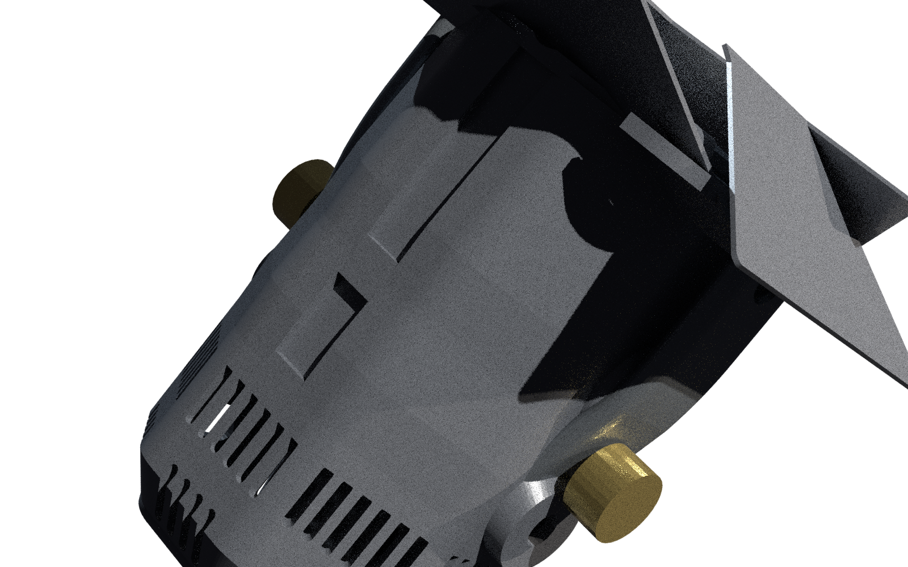
  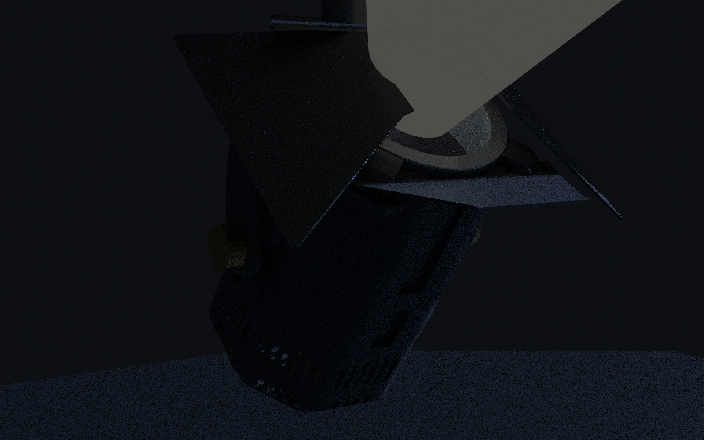
  <br/>
  <em>Left: Fully assembled AnymaSpot spotlight with 4-blade barndoors, sliding focus barrel, and mounting yoke.<br/>Right: Theatrical stage scenery — AnymaSpot clamped to an overhead 50mm lighting grid pipe, projecting a warm focused beam onto the stage.</em>
</p>

### Exploded Hardware Overview

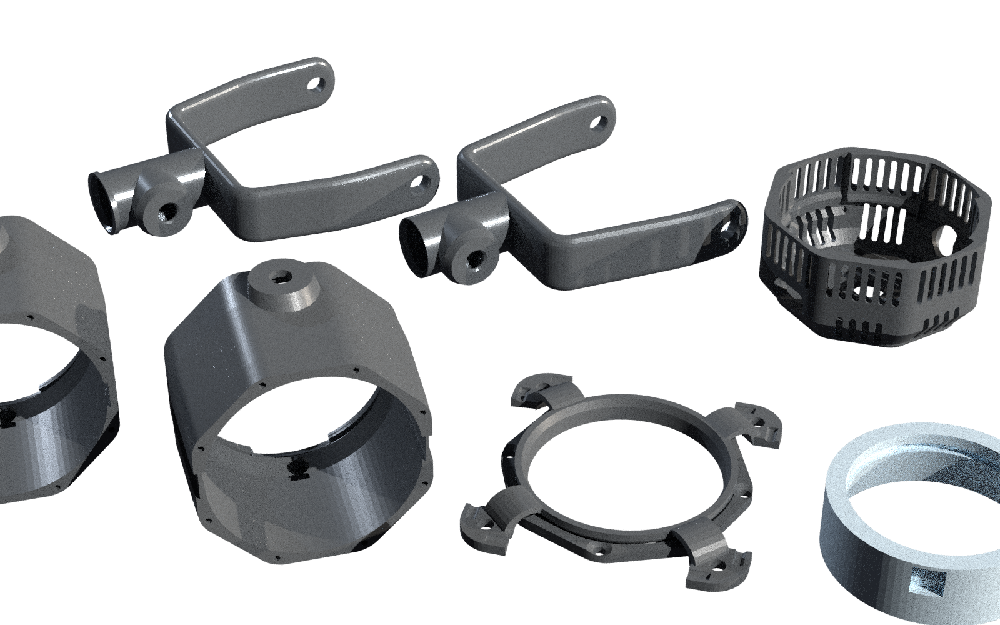

### Parts Breakdown

| File | Part Name | Function | Dimensions (mm) | Recommended Print Settings |
| :--- | :--- | :--- | :--- | :--- |
| **`anymaspot-12-short.stl`** | Body Chassis | Outer housing with ventilation louvers and yoke mounting bosses | 65.6 × 72.8 × 47.0 | PETG/ABS, 0.2mm, 4 walls, 25% infill |
| **`anymaspot-12-tube-short.stl`** | Focus Barrel | Concentric inner tube for sliding focal adjustment | 65.6 × 72.8 × 47.0 | Matte Black PETG (low internal reflection) |
| **`Biglens.stl`** | Lens Collar | Retaining ring for 57mm diameter condenser lens | 57.0 × 57.0 × 18.4 | PETG, 100% infill |
| **`Volet-Ring.stl`** | Accessory Ring | Front collar that clips to the barrel to hold barndoor leaves | 73.9 × 73.9 × 7.4 | PETG, 4 perimeters |
| **`volets-x-3.stl`** | Barndoor Blades | Set of 3 articulating shutters ("volets") for beam framing | 239.7 × 191.6 × 3.2 | PETG/Heat-resistant PLA, 100% infill |
| **`anymaspot-12-lyre.stl`** | 12cm Yoke | Standard theatrical hanging bracket for clamp/stand mounting | 80.0 × 99.1 × 18.9 | PETG, 6 perimeters, 40% infill |
| **`anymaspot-lyre7.stl`** | 7cm Yoke | Compact, low-profile bracket for tight rigging spaces | 80.0 × 96.1 × 18.9 | PETG, 6 perimeters, 40% infill |
| **`Back.stl`** | Rear Faceplate | Houses DC jack, USB-C opening, potentiometer knob, and LED status window | 64.7 × 64.7 × 32.6 | PETG, 0.2mm |

### Mechanical Visuals

<p align="center">
  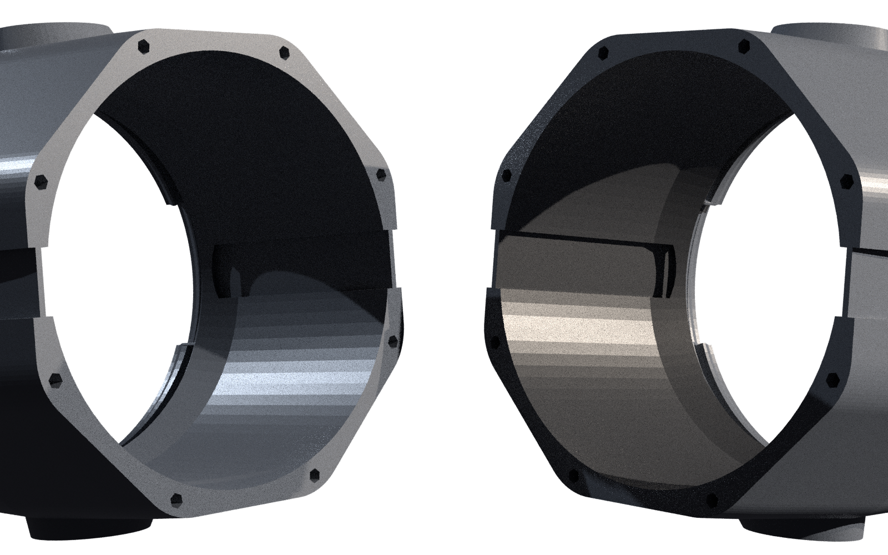
  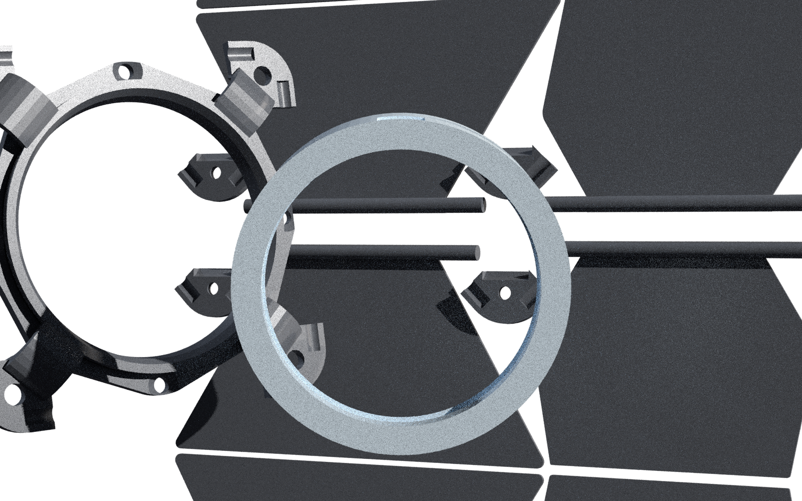
</p>
<p align="center">
  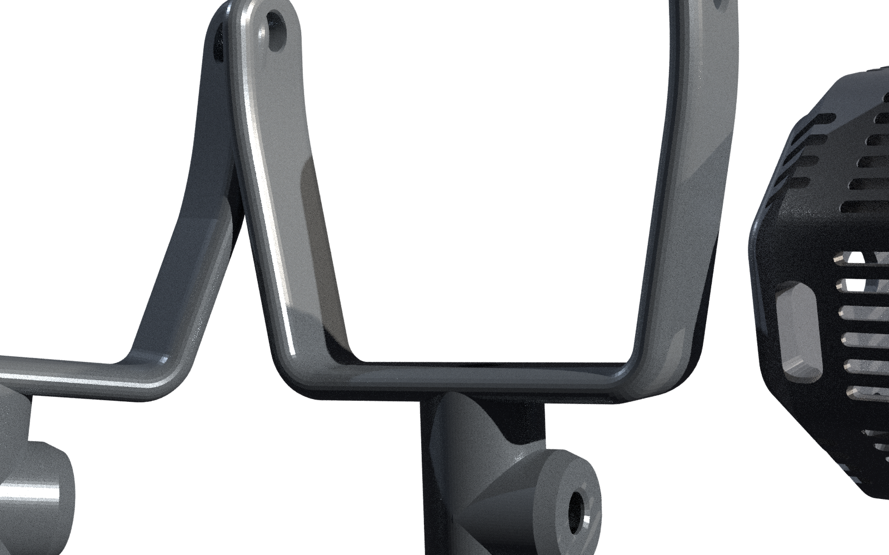
</p>

---

## Electronics & PCB Subsystems

The electronics are laid out across three custom boards designed in KiCad ([`electronics/`](../electronics/)):

### 1. `anymaspot-controller`
Brain board based on the **Espressif ESP32-C3-MINI-1** module (RISC-V 32-bit single-core, up to 160 MHz, 4MB Flash, Wi-Fi 4 + BLE 5.0).

<p align="center">
  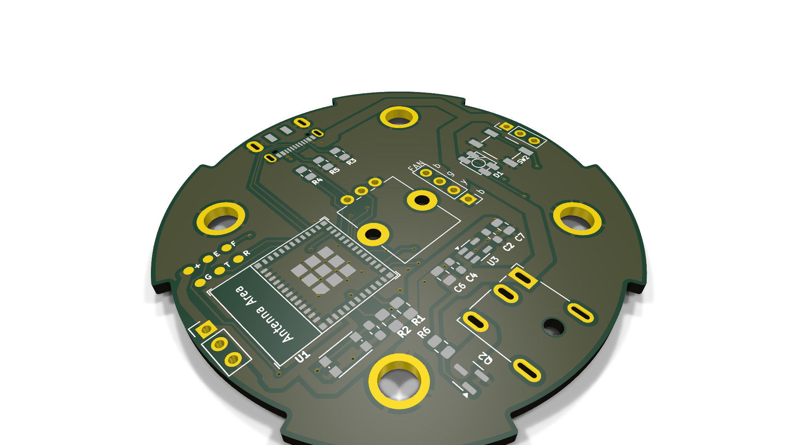
  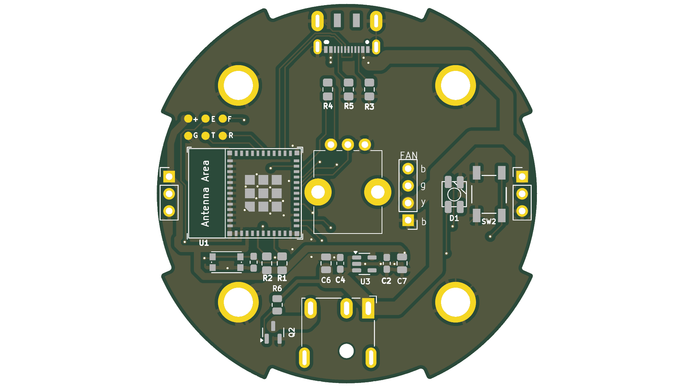
</p>

- **Power Regulation**: Torex **XC6220B331MR** high-speed low-dropout (LDO) regulator delivering 3.3V up to 1000 mA from the 5V bus.
- **User Interface**:
  - Precision rotary potentiometer (`RV`) connected to `GPIO4 / ADC1_CH4`.
  - Tactile push switch (`SW`) connected to `GPIO0`.
  - Addressable RGB NeoPixel (`SK6812MINI`) connected to `GPIO1` (`PIN_PIX`).
- **Cooling / Thermal**:
  - Fan drive MOSFET: **IRLML2502PBF** N-channel MOSFET for PWM speed control (`/fan_pwm`).
  - Fan tachometer sensor input (`/fan_sens`).
  - Thermal sensing pin header (`/temperature`).

### 2. `anymaspot-ledboard`
High-power LED engine and dedicated constant-current driver.

<p align="center">
  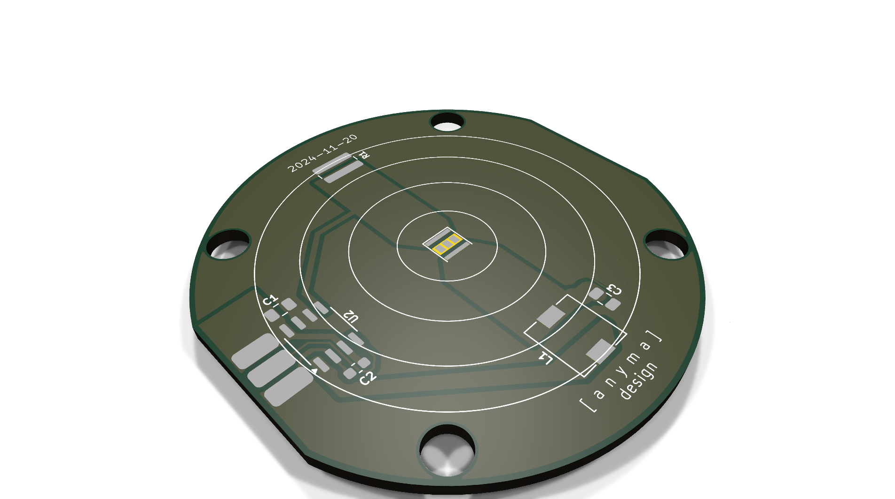
  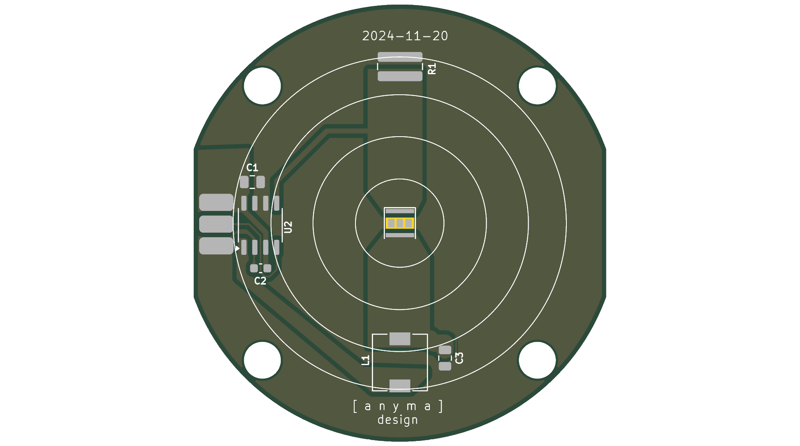
</p>

- **LED Emitter**: **Cree XLamp XP-G** (high efficiency, up to 1.5A driving capacity, footprint with dedicated central thermal slug).
- **Driver IC**: **STMicroelectronics LED2000** — 850 kHz, 3A step-down monolithic switching regulator.
  - Constant current regulation set by current-sense resistor `R1` ($0.47\,\Omega$).
  - High-speed direct logic DIM input connected to the microcontroller's PWM output.
  - Dedicated step-down power inductor `L1` ($1.5\,\mu\text{H}$) and input/output ceramic capacitors.

### 3. `anymaspot-mounting-ring`
Mechanical and thermal interface ring.

<p align="center">
  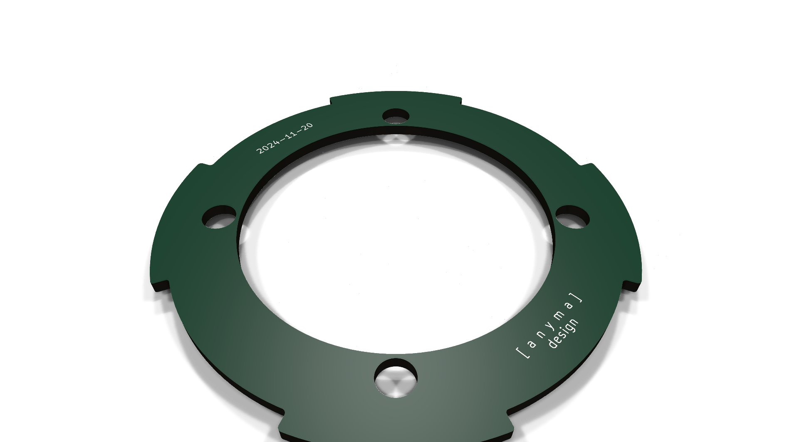
  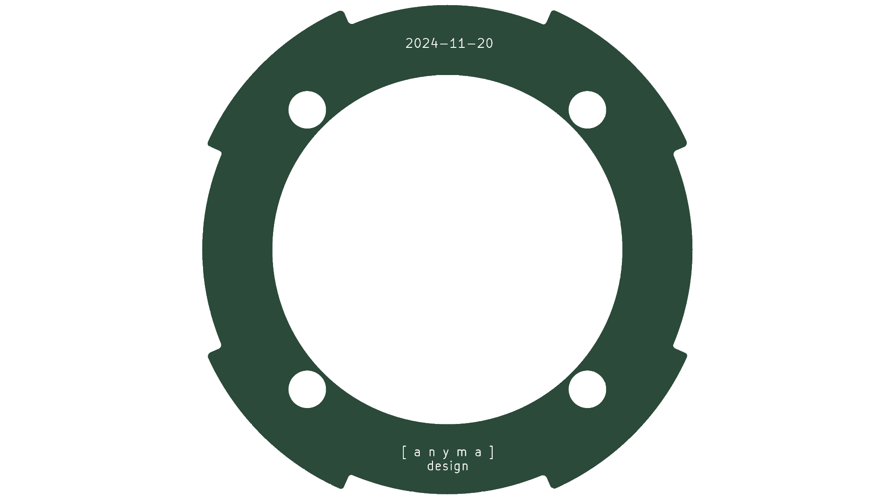
</p>

- Four M4 DIN965 countersunk mounting holes (`H1`, `H2`, `H3`, `H5`) to mount the heatsink and LED assembly rigidly within the 3D-printed outer tube.

---

## Firmware & Dimming Engine

The firmware is located in [`firmware/anyspot-basic/`](../firmware/anyspot-basic/) and builds with **PlatformIO**:

### 14-Bit Perceptual Dimming Pipeline
Human eye perception of luminous intensity is non-linear and follows Stevens' Power Law. Standard linear PWM causes noticeable jumps at low brightness and appears saturated at high levels.

AnymaSpots overcomes this with a **quartic ($x^4$) gamma transfer function** evaluated over **14-bit timer hardware (16,384 discrete levels)** at 200 Hz:

$$\text{PWM Duty} = \left(\frac{\text{ADC}_{\text{smoothed}}}{4095}\right)^4 \times 2^{14}$$

```cpp
// Read with 8-sample exponential moving average (EMA)
ad_val = (7 * ad_val + analogRead(PIN_POT)) / 8;

// Normalized intensity [0.0 ... 1.0]
intensity = (float)ad_val / 4095.0f;

// Quartic perceptual dimming curve
float f = pow(intensity, 4) * pow(2, LED_RESOLUTION);
ledcWrite(LED_CHANN, floor(f));
```

This ensures:
- Silky smooth fades from 100% down to total blackout with zero visible stepping.
- Deadband noise elimination from the analog wiper via EMA filtering.

---

## Wireless Mesh Architecture: Agora (`mirdej/Agora`)

The repository's current `firmware/anyspot-basic` provides a standalone test rig for local potentiometer reading and hardware PWM dimming. However, the architecture is designed around [**Agora** (`mirdej/Agora`)](https://github.com/mirdej/Agora), an open-source Arduino library developed by Michael Egger (`mirdej`) and Thomas Amberg for zero-configuration, connectionless **ESP-NOW** communication between ESP32 nodes.

### Code Scaffolding in `main.cpp`
Notice the global state variables in [`firmware/anyspot-basic/src/main.cpp`](../firmware/anyspot-basic/src/main.cpp):

```cpp
long last_message_millis;
int address = 0;
int long_address = 0;
bool connected = false;
bool muted = false;
```

These variables represent the core state machine of an **Agora Actor Node**:
1. **The "Tribe" Concept**: AnymaSpots assemble into a wireless "Tribe" defined by a shared identifier. Nodes discover peers automatically without requiring Wi-Fi router associations, DHCP leasing, or DNS lookups.
2. **Sub-Millisecond Cueing**: Lighting cues, master blackout (`muted`), and level packets are broadcast directly at the MAC 802.11 physical layer via ESP-NOW, providing latency under $1\,\text{ms}$ with zero risk of router overload in theatrical venues.
3. **Failsafe Potentiometer Fallback**: When communication is active, remote Agora packets dictate intensity. If no packet is received for a predefined timeout ($\Delta t > \text{TIMEOUT}$ via `last_message_millis`), the node seamlessly falls back to local manual control via the rear potentiometer.
4. **Visual Health State**: The onboard `SK6812MINI` addressable NeoPixel provides immediate optical feedback:
   - 🟢 **Solid Green**: Connected to Agora Tribe, actively receiving master frames.
   - 🟡 **Pulsing Yellow / Amber**: Searching for Agora Tribe beacon / local fallback mode.
   - 🔴 **Solid Red**: Muted / blackout override active.

---

## Next-Generation Optics: LEP (Laser Excited Phosphor)

A natural technological evolution for the AnymaSpot profile fixture is replacing the traditional surface-mount LED with **LEP (Laser Excited Phosphor)** technology.

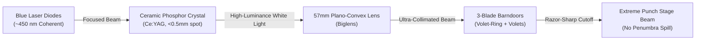

### Optical Physics Comparison: LED vs. LEP

| Metric | Cree XLamp XP-G (Current LED) | LEP (Laser Excited Phosphor) | Impact on AnymaSpots |
| :--- | :--- | :--- | :--- |
| **Emitter Surface Area** | $3.45 \times 3.45\,\text{mm}$ ($\approx 4\,\text{mm}^2$ active die) | $\approx 0.1 \text{ to } 0.4\,\text{mm}^2$ focal spot | **Near point-source geometry** |
| **Luminance ($L$)** | $\approx 80\text{--}150\,\text{cd/mm}^2$ | $\approx 1000\text{--}4000\,\text{cd/mm}^2$ | **10× to 30× higher luminance punch** |
| **Emission Angle** | $\approx 125^\circ$ Lambertian | Micro-cone / directional reflection | **Minimal wasted spill inside chassis** |
| **Optical Etendue ($A \cdot \Omega$)** | High ($~12\,\text{mm}^2\cdot\text{sr}$) | Extremely low ($<0.5\,\text{mm}^2\cdot\text{sr}$) | **Allows razor-sharp collimation with small 57mm lens** |
| **Beam Profile** | Soft penumbra edge, wide beam | Crisp pencil-beam, razor-sharp cutoff | **Barndoors ("volets") cut perfectly without fuzzy blur** |
| **Thermal Concentration** | Front face of LED die | Rear laser diode sink | **Heat moved away from 3D-printed lens barrel** |

### Implementation Considerations for an LEP Fork:
1. **Driver Circuitry**: Unlike the LED2000 step-down buck driver which can handle broad inductor tolerances, blue laser diodes require transient-free, ultra-low-ripple constant-current regulation with fast soft-start to prevent laser diode spike degradation.
2. **Optical Enclosure Safety**: The chassis must ensure that the phosphor element cannot be displaced while energized, preventing unscattered coherent blue laser energy from escaping through the lens.
3. **CCT & Color Rendering**: Modern ceramic phosphors achieve CRI $70\text{--}85$ with daylight white ($5500\text{--}6500\,\text{K}$), ideal for dramatic theatrical beams, punchy architectural micro-spots, and gobo projection.

---

## Pinout & Interconnect Map

| ESP32-C3 Pin | Net Name | Function |
| :--- | :--- | :--- |
| **GPIO0** | `/sw` | Push button (active LOW, boot strapping) |
| **GPIO1** | `/pix` | Data in for SK6812MINI addressable RGB status LED |
| **GPIO4** | `/ad` | Analog input from manual dimming potentiometer |
| **GPIO10** | `/pwm` | 14-bit LED dimming PWM signal to LED2000 DIM pin |
| **GPIO6** | `/fan_pwm` | PWM control for optional fan driver MOSFET |
| **GPIO7** | `/fan_sens`| Tachometer pulse input from cooling fan |
| **GPIO3** | `/temperature` | Analog input for thermal sensor / NTC |
| **GPIO18 (USB D-)** | `Net-(J3-DN)` | USB 2.0 Differential Data Negative |
| **GPIO19 (USB D+)** | `Net-(J3-DP)` | USB 2.0 Differential Data Positive |

---

## Enhancement Roadmap

- [ ] **Wireless DMX / Art-Net / sACN**: Utilize ESP32-C3 Wi-Fi to listen for Art-Net packets on UDP port 6454.
- [ ] **Web Configuration Portal**: Embedded captive portal / web UI to patch DMX universe, start address, and dimming curves over Wi-Fi.
- [ ] **Active Thermal Foldback**: Auto-derating of maximum drive current if temperature exceeds safe thresholds (preventing 3D-printed enclosure deformation).
- [ ] **ESP-NOW Mesh**: Wirelessly link multiple AnymaSpots into synchronized clusters without an external Wi-Fi router.
